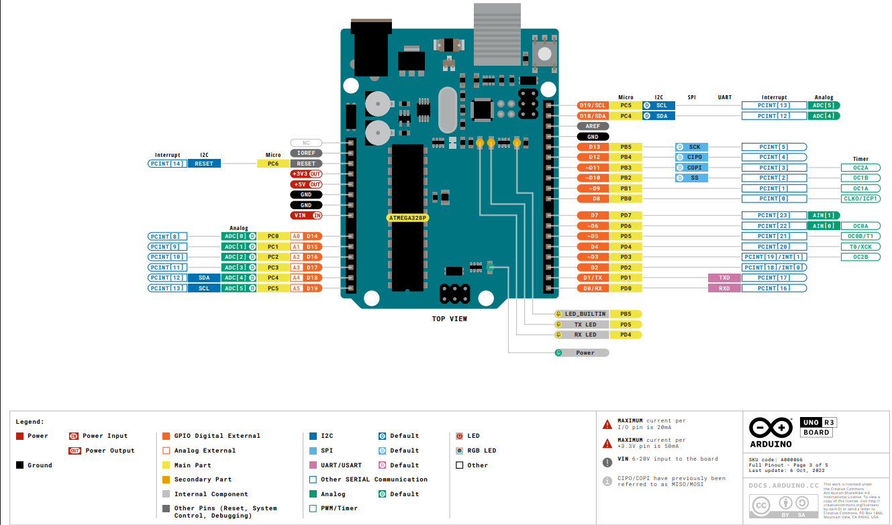

# 🤖 Monitoría: Instalación y manejo de Arduino


## ¿Qué es?

Material de la monitoría **"Instalación y manejo de Arduino"** para los estudiantes de **Introducción a la Ingeniería Electrónica** de la Universidad Nacional de Colombia.

El objetivo es que cualquier estudiante, **sin experiencia previa en programación ni en electrónica**, salga de la sesión con:

- El **Arduino IDE instalado y funcionando** en su computador (Windows, Linux o macOS).
- La **placa reconocida** por el sistema y el primer programa cargado.
- Criterio para **conectar componentes sin quemar nada** (corriente, voltaje, pines).
- **14 ejemplos de código** progresivos, desde un LED que parpadea hasta una barrera con servo y aviso sonoro.

> Todo el código está comentado en español y pensado para leerse en clase, no para copiarse a ciegas.

## ✨ Contenido

| Módulo | Qué encontrarás | Estado |
|---|---|---|
| 📥 Instalación | Arduino IDE 2.x en Windows / Linux / macOS, **drivers CH340 y CP2102**, permisos y puerto | ✅ |
| 🔌 Hardware | Pinout del UNO R3, límites eléctricos reales, alimentación | ✅ |
| 💻 Lenguaje | `setup()`, `loop()`, variables, `digitalWrite`, `analogRead`, `Serial`, `millis()` | ✅ |
| 🧪 Ejemplos | 14 sketches numerados y funcionales | ✅ |
| 🧰 Cheatsheet | Resumen de una página para tener al lado mientras programas | ✅ |
| 🛠️ Buenas prácticas | Antirrebote, `millis()` vs `delay()`, protecciones eléctricas | ✅ |

## 🗺️ Diagrama de la sesión

```
        ┌──────────────────────────────────────────────────────┐
        │  1. INSTALAR        Arduino IDE + drivers            │
        │         │                                            │
        │         ▼                                            │
        │  2. CONECTAR       USB → placa → puerto en el IDE    │
        │         │                                            │
        │         ▼                                            │
        │  3. PROGRAMAR      setup() / loop() → Blink          │
        │         │                                            │
        │         ▼                                            │
        │  4. LEER Y ESCRIBIR  digital / analog / Serial       │
        │         │                                            │
        │         ▼                                            │
        │  5. INTEGRAR       sensor + actuador + lógica        │
        └──────────────────────────────────────────────────────┘
```

## 📁 Estructura del repositorio

```
Monitoria_Arduino_Intro_IE/
├── README.md
├── LICENSE
├── .gitignore
├── docs/
│   ├── 01_instalacion.md        # IDE por SO + drivers CH340/CP2102 + errores
│   ├── 02_hardware_uno_r3.md    # pinout, límites de corriente, alimentación
│   ├── 03_lenguaje_esencial.md  # el lenguaje mínimo para la sesión
│   ├── 04_buenas_practicas.md   # antirrebote, millis(), protecciones
│   ├── CHEATSHEET.md            # resumen de una página
│   └── img/
│       └── pinout_uno_r3.png    # diagrama de pinout del UNO R3
├── ejemplos/
│   ├── 01_blink/
│   ├── 02_semaforo_peatonal/
│   ├── 03_boton_antirrebote/
│   ├── 04_potenciometro_serial/
│   ├── 05_pwm_respiracion/
│   ├── 06_buzzer_melodia/
│   ├── 07_ldr_alarma/
│   ├── 08_ultrasonido/
│   ├── 09_control_serial/
│   ├── 10_ultrasonico_led_proyecto/
│   ├── 11_ldr_led_proyecto/
│   ├── 12_ldr_led_notification/
│   ├── 13_servo_barrera/
│   └── 14_servo_buzzer/
└── hardware/
    ├── lista_materiales.md      # qué comprar y cuánto cuesta (COP)
    └── conexiones.md            # diagramas de cada montaje
```

## 🔧 Hardware de referencia

| Componente | Cantidad | Uso en la monitoría |
|---|---|---|
| Arduino UNO R3 (o compatible) | 1 | Placa base |
| Protoboard | 1 | Montajes sin soldar |
| LEDs (rojo, amarillo, verde) | 3 | Salidas digitales |
| Resistencias 220 Ω | 3 | Limitar corriente de LEDs |
| Resistencias 10 kΩ | 1 | Divisor del LDR |
| Pulsador | 1 | Entrada digital |
| Potenciómetro 10 kΩ | 1 | Entrada analógica |
| LDR | 1 | Sensor de luz |
| Buzzer activo o pasivo | 1 | Actuador |
| Servo SG90 (o similar) | 1 | Barrera de los ejemplos 13 y 14 |
| Fuente externa de 5 V | 1 | Alimentar el servo (nunca el pin 5V) |
| HC-SR04 | 1 | Sensor de distancia |
| Cables dupont | 20 | Conexiones |
| Cable USB | 1 | Programación y alimentación |

Lista detallada con precios aproximados en [`hardware/lista_materiales.md`](hardware/lista_materiales.md).

### 📌 Pinout del UNO R3



Pinout completo con límites eléctricos en [`docs/02_hardware_uno_r3.md`](docs/02_hardware_uno_r3.md). Diagramas de cada montaje en [`hardware/conexiones.md`](hardware/conexiones.md).

📄 **Datasheet oficial:** [Arduino UNO R3 — A000066](https://docs.arduino.cc/resources/datasheets/A000066-datasheet.pdf)

## 🚀 Cómo usar el repositorio

1. Instala el IDE siguiendo [`docs/01_instalacion.md`](docs/01_instalacion.md).
2. Abre el primer ejemplo: `ejemplos/01_blink/01_blink.ino`.
3. Selecciona **Herramientas → Placa → Arduino Uno** y el **puerto** correspondiente.
4. Carga el programa con el botón **→ (Subir)**.
5. Avanza en orden: cada ejemplo usa algo del anterior.

> Los sketches están en carpetas con el mismo nombre del archivo `.ino` (obligatorio en Arduino).

## 🎓 Ruta de aprendizaje

| Fase | Tema | Ejemplo | Estado |
|---|---|---|---|
| 1 | Salida digital y estructura del programa | `01_blink` | ✅ |
| 2 | Secuencias temporizadas | `02_semaforo_peatonal` | ✅ |
| 3 | Entrada digital y antirrebote | `03_boton_antirrebote` | ✅ |
| 4 | Entrada analógica y monitor serial | `04_potenciometro_serial` | ✅ |
| 5 | PWM (intensidad variable) | `05_pwm_respiracion` | ✅ |
| 6 | Sonido con `tone()` | `06_buzzer_melodia` | ✅ |
| 7 | Sensado con umbral e histéresis | `07_ldr_alarma` | ✅ |
| 8 | Medición de tiempo con `pulseIn()` | `08_ultrasonido` | ✅ |
| 9 | Comunicación PC ↔ placa | `09_control_serial` | ✅ |

## 🧠 Stack

- **Hardware:** Arduino UNO R3 (ATmega328P, 16 MHz)
- **Software:** Arduino IDE 2.x · `arduino-cli` (opcional) · PlatformIO (opcional)
- **Lenguaje:** C++ simplificado (Arduino API)
- **Documentación:** Markdown

## ⚠️ Advertencia eléctrica

El UNO R3 **no** es una fuente de potencia. Cada pin entrega **20 mA recomendados (40 mA absoluto)** y el chip completo **200 mA**. Servos, motores y tiras LED se alimentan con **fuente externa y GND común**. Ver [`docs/02_hardware_uno_r3.md`](docs/02_hardware_uno_r3.md).

## Autor

**Yeison Dénnir Termal Cuastumal** — Ingeniería Electrónica, Universidad Nacional de Colombia 2026.

Licencia [MIT](LICENSE).
